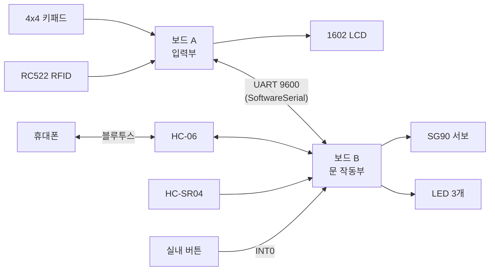
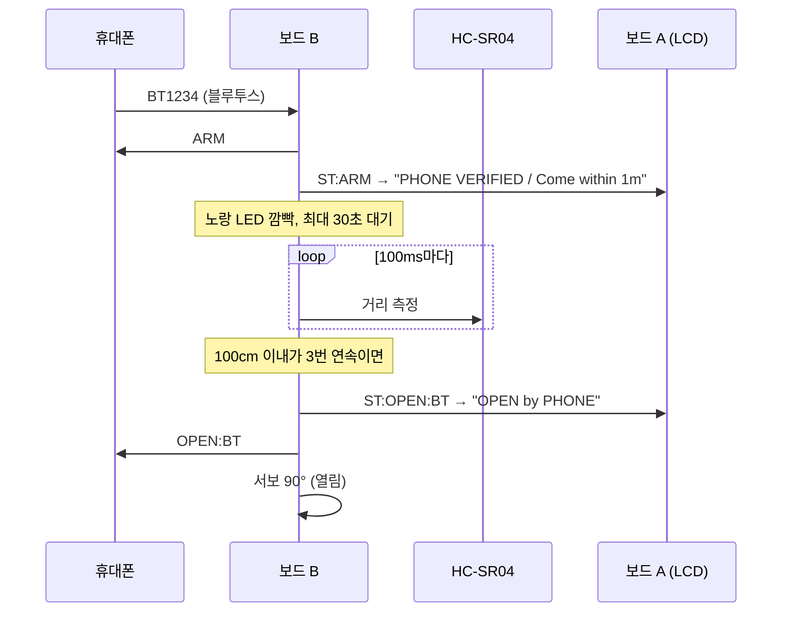

# Arduino 스마트 도어락 (기말 과제)

Arduino Uno(ATmega328P) **2대**를 UART로 연결해 만든 도어락이다.
키패드, RFID, 휴대폰(블루투스 + 1m 접근), 실내 버튼, 이렇게 4가지 방법으로 문을 열 수 있다.
열린 문은 5초 뒤 자동으로 잠긴다.

> 📐 실물 비율 브레드보드 배치도, 단계별 배선 순서, 분압 회로 확대도, 보드 A 테스트, 안전 점검표는 [`docs/wiring.html`](docs/wiring.html)을 브라우저로 열면 볼 수 있다.

---

## 목차
1. [전체 구성](#1-전체-구성)
2. [작동 과정](#2-작동-과정)
3. [준비물](#3-준비물)
4. [배선](#4-배선)
5. [만드는 순서](#5-만드는-순서)
6. [사용법](#6-사용법)
7. [설정값 바꾸기](#7-설정값-바꾸기)
8. [문제 해결](#8-문제-해결)
9. [파일 구조](#9-파일-구조)
10. [한계와 개선점](#10-한계와-개선점)

---

## 1. 전체 구성

| 보드 | 역할 | 연결된 모듈 |
|---|---|---|
| **A (입력부)** | 비밀번호·RFID 판정, LCD 표시 | 4x4 키패드, RC522 RFID, 1602 LCD(I2C) |
| **B (문 작동부)** | 문 열고 닫기, 휴대폰 인증, 1m 판정 | SG90 서보, HC-06 블루투스, HC-SR04 초음파, LED 3개, 실내 버튼 |



### 과제 조건 대응
| 조건 | 구현 |
|---|---|
| 보드 2대 시리얼 통신 | 보드 A `A1(RX)/A2(TX)` ↔ 보드 B `D5(TX)/D4(RX)`, SoftwareSerial 9600bps |
| 외부 인터럽트 | 보드 B `D2` = INT0, 실내 버튼, `FALLING`, `millis()` 300ms로 채터링 방지 |
| 내부 인터럽트 | 보드 B `MsTimer2` 100ms 주기, 자동 잠금 / 휴대폰 인증 만료 / LED 깜빡임 |
| 블루투스 + 1m | HC-06로 휴대폰 인증 → HC-SR04로 100cm 이내 접근 확인 |
| 키패드 | 비밀번호 입력 (`*` 지우기, `#` 확인) |
| RFID | 등록된 카드 UID 비교 |
| 디스플레이 | LCD에 입력값(`*`), 결과, 문 상태 표시 |
| LED | 초록=열림, 노랑 깜빡=휴대폰 인증됨, 빨강=잠김/실패 |

---

## 2. 작동 과정

### 2-1. 키패드로 열기
1. 키패드로 숫자를 누르면 LCD 2번째 줄에 `PW:****`처럼 `*`가 늘어난다.
   - `*`를 누르면 전체 지우기, `A`~`D`는 무시된다.
2. `#`을 누르면 보드 A가 비밀번호(기본 `1234`)와 비교한다.
3. **맞으면** LCD에 `ACCESS GRANTED`가 뜨고, 보드 B로 `OPEN:KEY`를 보낸다.
4. 보드 B가 먼저 보드 A로 `ST:OPEN:KEY`를 보내고, 그다음 서보를 90°로 돌려 문을 연다. 초록 LED는 100ms 타이머 인터럽트가 켠다.
   - 상태를 먼저 보내는 이유: SoftwareSerial로 보내는 동안 인터럽트가 잠깐 막혀서 서보 펄스가 흔들리기 때문이다.
5. 5초 뒤 보드 B의 타이머 인터럽트가 자동 잠금 플래그를 세운다. 서보는 0°로 돌아가고, 보드 A로 `ST:LOCK`이 간다.
6. **틀리면** LCD 1번째 줄에 `ACCESS DENIED`, 2번째 줄에 `KEY  (1/3)`가 뜨고, 보드 B는 빨강 LED를 2초 동안 빠르게 깜빡인다.
   - 3번 연속 틀리면 `TOO MANY FAILS / Wait 30 sec`가 뜨고 30초 동안 키패드와 RFID 입력이 차단된다.

### 2-2. RFID로 열기
1. 카드를 RC522에 대면 보드 A가 카드의 4바이트 UID를 읽는다.
2. 코드의 `ALLOWED_UID` 목록과 같으면 `ACCESS GRANTED`를 띄우고 `OPEN:RFID`를 보낸다. 이후는 키패드와 같다.
3. 등록되지 않은 카드면 `ACCESS DENIED`와 함께 LCD 2번째 줄에 그 카드의 UID가 표시된다.
   - 실패 횟수는 키패드와 함께 센다.

### 2-3. 휴대폰(블루투스 + 1m)으로 열기

1. 휴대폰의 **Serial Bluetooth Terminal** 앱으로 HC-06에 연결하고 `BT1234`를 보낸다.
2. 보드 B가 인증에 성공하면 **ARM 상태**가 된다. 노랑 LED가 깜빡이고, 최대 30초 동안 접근을 기다린다.
3. ARM 상태에서만 초음파 센서가 100ms마다 거리를 잰다. **3번 연속 100cm 이내**면 문이 열린다.
4. 30초 안에 다가오지 않으면 `ARMEND`(LCD에 `PHONE TIMEOUT`)가 뜨고 다시 비밀번호를 보내야 한다.
5. 블루투스 비밀번호가 틀리면 `BTFAIL`이 뜬다. **3번 연속 틀리면** 30초 동안 블루투스 입력을 무시한다.
6. 휴대폰에서 `LOCK`을 보내면 즉시 잠긴다.

> **왜 초음파를 같이 쓰나?** HC-06은 신호 세기(RSSI)를 아두이노에 알려주지 않아서 블루투스만으로는 거리를 잴 수 없다. 그래서 블루투스로 **누구인지** 인증하고, 초음파로 **얼마나 가까운지** 재는 2단계 방식을 썼다.

### 2-4. 실내 버튼으로 열기 (외부 인터럽트)
1. 버튼은 `D2`와 GND 사이에 연결되고, `INPUT_PULLUP`이라 평소에는 HIGH다.
2. 누르는 순간 HIGH → LOW로 떨어지면(`FALLING`) INT0 인터럽트가 실행된다.
3. ISR은 직전 실행으로부터 300ms가 지났을 때만 플래그를 세운다(채터링 방지).
4. `loop()`가 플래그를 보고 문을 열고, 보드 A로 `ST:OPEN:BTN`을 보낸다. LCD에는 `OPEN from INSIDE button`이 뜬다.

### 2-5. 타이머 인터럽트 (MsTimer2, 100ms)
`isrTick()`이 100ms마다 실행되면서 아래 일을 한다.

| 카운터 | 하는 일 |
|---|---|
| `openTicks` (50 = 5초) | 0이 되면 자동 잠금 플래그 |
| `armTicks` (300 = 30초) | 0이 되면 휴대폰 인증 만료 플래그 |
| `servoOffTicks` (8 = 0.8초) | 0이 되면 서보 detach 플래그 (떨림 방지) |
| `failTicks` (20 = 2초) | 0이 될 때까지 빨강 LED 빠르게 깜빡임 |

LED 표시도 ISR에서 직접 처리한다. 서보 이동이나 시리얼 전송 같은 무거운 일은 ISR에서 하지 않는다. ISR은 `volatile` 플래그만 세우고, 실제 처리는 `loop()`가 한다.

### 2-6. 보드 간 통신 규약
한 줄에 메시지 하나를 보낸다. 보낼 때는 `println()`이라 줄 끝이 `\r\n`이고, 받는 쪽은 `\r`나 `\n` 중 하나만 와도 한 줄로 처리한다(빈 줄은 무시).

| 방향 | 메시지 | 의미 |
|---|---|---|
| A → B | `OPEN:KEY`, `OPEN:RFID` | 문 열기 |
| A → B | `FAIL:KEY`, `FAIL:RFID` | 실패 표시 (빨강 LED 깜빡) |
| B → A | `ST:OPEN:KEY` / `RFID` / `BT` / `BTN` | 문이 열림 (+ 연 방법) |
| B → A | `ST:LOCK` | 문이 잠김 |
| B → A | `ST:ARM`, `ST:ARMEND`, `ST:BTFAIL` | 휴대폰 인증 성공 / 만료 / 실패 |

### 2-7. 상태 표시
| LED (보드 B) | 의미 |
|---|---|
| 🔴 빨강 켜짐 | 잠김 |
| 🔴 빨강 빠르게 깜빡 | 인증 실패 (2초) |
| 🟡 노랑 깜빡 | 휴대폰 인증됨, 1m 접근 대기 (최대 30초) |
| 🟢 초록 켜짐 | 열림 (5초 뒤 자동 잠금) |

| LCD (보드 A) | 상황 |
|---|---|
| `Door:LOCKED` / `PW:***` | 기본 화면 (문 상태 + 입력 중인 비밀번호) |
| `ACCESS GRANTED` | 키패드·RFID 인증 성공 |
| `ACCESS DENIED` | 인증 실패 (실패 횟수 또는 카드 UID 표시) |
| `TOO MANY FAILS` | 3회 실패, 30초 입력 차단 |
| `PHONE VERIFIED` | 휴대폰 인증 성공, 1m 이내로 오라는 안내 |
| `OPEN by PHONE` / `OPEN from INSIDE button` | 휴대폰 / 실내 버튼으로 열림 |
| `PHONE TIMEOUT` / `PHONE PW WRONG` | 휴대폰 인증 만료 / 블루투스 비밀번호 틀림 |

---

## 3. 준비물

| 부품 | 수량 | 비고 |
|---|---|---|
| Arduino Uno R3 | 2 | ATmega328P, USB 케이블 2개 |
| 4x4 멤브레인 키패드 | 1 | |
| RC522 RFID 모듈 + 카드/태그 | 1 | **3.3V 전용** |
| 1602 LCD + I2C 모듈(PCF8574) | 1 | 뒷면에 4핀(GND·VCC·SDA·SCL) |
| HC-06 블루투스 모듈 | 1 | |
| HC-SR04 초음파 센서 | 1 | |
| SG90 서보모터 | 1 | |
| LED (빨강, 노랑, 초록) | 각 1 | |
| 푸시 버튼 | 1 | |
| 저항 2kΩ | 6 | RC522 SCK·MOSI 분압 (채널당 3개) |
| 저항 10kΩ | 3 | RC522 SDA 분압 (5개 중 3개 사용) |
| 저항 220Ω | 9 | HC-06 분압 6개 + LED 3개 (10개 중 9개 사용) |
| 전해 커패시터 470µF | 1 | 서보 전원 안정화 |
| 서보용 5V 외부전원 | 1 | 5V 1A 이상 어댑터 또는 브레드보드 전원모듈 |
| 브레드보드, 점퍼선 | | |
| 안드로이드 휴대폰 | 1 | `Serial Bluetooth Terminal` 앱 |

### 라이브러리 (Arduino IDE → Library Manager, `Ctrl+Shift+I`)
| 검색어 | 작성자 | 필요한 보드 |
|---|---|---|
| `LiquidCrystal I2C` | **Frank de Brabander** | A |
| `Keypad` | **Mark Stanley, Alexander Brevig** | A |
| `MFRC522` | **GithubCommunity** (miguelbalboa) | A |
| `MsTimer2` | Javier Valencia (PaulStoffregen 관리) | B |

`Wire`, `SPI`, `SoftwareSerial`, `Servo`는 기본 내장이다.
> ⚠️ 이름이 비슷한 다른 라이브러리(`Adafruit Keypad`, `MFRC522v2`, `LiquidCrystal_PCF8574` 등)는 사용법이 달라서 컴파일되지 않는다. **작성자 이름**을 확인하고 설치한다.

---

## 4. 배선

### 보드 A (입력부)
| 모듈 핀 | 보드 A 핀 | 비고 |
|---|---|---|
| 키패드 C4, C3, C2, C1 | D8, D7, D6, D5 | 키패드 핀 1~4번 (위부터) |
| 키패드 R1, R2, R3, R4 | D4, D3, D2, A0 | 키패드 핀 5~8번 |
| RC522 SDA(SS) | D10 | 10kΩ / 10kΩ+10kΩ 분압 |
| RC522 SCK | D13 | 2kΩ / 2kΩ+2kΩ 분압 |
| RC522 MOSI | D11 | 2kΩ / 2kΩ+2kΩ 분압 |
| RC522 MISO | D12 | **직결** |
| RC522 RST | **3.3V** | 저항 없이 3.3V에 직결 (코드는 리셋 핀 사용 안 함) |
| RC522 3.3V / GND | **3.3V** / GND | ⚠️ 5V 금지. IRQ는 연결 안 함 |
| LCD SDA / SCL | A4 / A5 | |
| LCD VCC / GND | 5V / GND | |
| 링크 RX / TX | A1 / A2 | 보드 B의 D5 / D4로 |

**브레드보드 레일 순서:** 이 프로젝트에서 쓰는 브레드보드는 레일 쌍마다 **−가 위, +가 아래**다. 위쪽 쌍은 바깥이 −, a줄 쪽이 +이고, 아래쪽 쌍은 j줄 쪽이 −, 바깥이 +다. 그래서 보드 A의 분압은 아래쪽 절반(f~j줄)에 만들어 마지막 저항이 j줄 바로 아래 − 레일에 꽂히게 하고, 보드 B의 HC-06 분압은 마지막에 검정 점퍼선으로 맨 위 − 레일에 잇는다. 다른 브레드보드를 쓰면 레일 옆의 색·기호를 보고 맞춘다.

**분압 회로**(RC522 SDA·SCK·MOSI, HC-06 RXD 총 4채널)는 이렇게 만든다.
```
아두이노 핀 ──[위 R]──┬── 모듈 핀   (위 : 아래 = 1 : 2 → 5V × 2/3 ≈ 3.33V)
                      │
                   [아래 R]
                   [아래 R]   (같은 저항 2개 직렬 = 2배)
                      │
                     GND
```
| 채널 | 위 | 아래 (직렬) | 이유 |
|---|---|---|---|
| RC522 SCK · MOSI | 2kΩ | 2kΩ + 2kΩ | 4MHz로 빠른 신호라 작은 저항 필요 |
| RC522 SDA (SS) | 10kΩ | 10kΩ + 10kΩ | 통신 시작·끝에만 바뀌는 느린 신호라 10kΩ도 됨 (2kΩ이 6개뿐이라) |
| HC-06 RXD | 220Ω + 220Ω | 220Ω × 4 | 남은 저항이 220Ω뿐이라 6개로 같은 1:2 비율을 만듦 |

- 새로 살 부품 없이 보유 저항(2kΩ 6개, 10kΩ 5개, 220Ω 10개)으로 만든다. 1kΩ 4개를 구하면 4채널 모두 1kΩ+2kΩ(2개씩)로 줄일 수 있다.
- RC522는 2.3V 이상이면 HIGH로 읽고 최대 약 3.8V까지 버티므로 3.33V는 안전한 범위다.
- **위 1개, 아래 2개**다. 뒤집으면 약 1.7V가 되어 신호를 못 읽는다.
- 마지막 아래 저항의 GND 쪽 다리는 **파란 줄(−) 레일**에 꽂는다. 브레드보드에 따라 a줄 바로 옆이 + 레일인 제품도 있으니 위치가 아니라 색·기호로 확인한다.
- 전원을 끄고 선을 뺀 상태에서 N칸↔− 레일 저항이 SCK·MOSI ≈ 4kΩ, SDA ≈ 20kΩ, HC-06 ≈ 880Ω이면 맞다.
- SCK·MOSI를 10kΩ으로 만들면 안 된다. 저항이 크면 SPI(4MHz) 신호가 제때 올라가지 못해 통신이 깨진다.
- 브레드보드 배치(어느 칸에 꽂는지)는 [`docs/wiring.html`](docs/wiring.html)의 "분압 회로 자세히"에 그림으로 있다.

### 보드 B (문 작동부)
| 모듈 핀 | 보드 B 핀 | 비고 |
|---|---|---|
| HC-06 TXD | D0 (RX) | ⚠️ **업로드 전에 뽑기** |
| HC-06 RXD | D1 (TX) | 220Ω+220Ω / 220Ω×4 분압 (HC-06 RX는 3.3V) |
| HC-06 VCC / GND | 5V / GND | |
| 실내 버튼 | D2 ↔ GND | 저항 필요 없음 (`INPUT_PULLUP`) |
| 링크 RX / TX | D4 / D5 | 보드 A의 A2 / A1로 |
| HC-SR04 Trig / Echo | D6 / D7 | VCC 5V, GND |
| 초록 / 노랑 / 빨강 LED | D10 / D11 / D12 | 각각 220Ω 직렬. 긴 다리(+)가 저항 쪽 |
| SG90 신호(주황) | A0 | |
| SG90 전원(빨강) / GND(갈색) | **외부 5V** / 외부 GND | 외부 GND ↔ 아두이노 GND 연결 필수 |

### 보드 A ↔ 보드 B
| 보드 A | 보드 B |
|---|---|
| A2 (TX) | D4 (RX) |
| A1 (RX) | D5 (TX) |
| GND | GND |

TX와 RX는 서로 **엇갈려** 연결한다. **두 보드의 5V끼리는 연결하지 않는다.** 각 보드는 자기 USB로 전원을 받는다.

### ⚠️ 보드나 모듈이 망가질 수 있는 실수
1. **RC522 VCC를 5V에 연결하기.** 반드시 3.3V에 연결한다.
2. **서보 전원을 아두이노 5V에서 끌어오기.** 서보가 움직일 때 전류가 튀어서 보드가 리셋되거나 USB 포트가 위험해진다.
3. **두 보드의 5V 핀끼리 연결하기.**
4. **470µF 커패시터 극성 반대로 꽂기.** 긴 다리가 +, 띠 표시 쪽이 −다.

---

## 5. 만드는 순서

**한 번에 다 꽂지 말고**, 모듈 하나 연결 → 테스트 → 다음 순서로 진행한다. 배선은 항상 **USB를 뽑은 상태**에서 한다.

### 1단계: 준비
1. Arduino IDE를 설치하고 [라이브러리](#라이브러리-arduino-ide--library-manager-ctrlshifti) 4개를 설치한다.
2. `도구 → 보드 → Arduino Uno`, `도구 → 포트`에서 연결된 포트를 선택한다.

### 2단계: 보드 A 만들고 테스트
`firmware/tests/`의 테스트 스케치를 순서대로 올린다. 시리얼 모니터는 **9600**으로 맞춘다.

| 순서 | 연결할 것 | 업로드할 스케치 | 통과 기준 |
|---|---|---|---|
| ① | LCD | `tools/i2c_scanner` | `Found: 0x27`(또는 `0x3F`) 출력. 다른 값이면 `A1_lcd_test.ino`와 `board_A_input.ino`의 `LCD_ADDR`를 그 값으로 수정 |
| ② | (그대로) | `tests/A1_lcd_test` | 백라이트가 **5초마다 깜빡임**. 글자가 안 보이면 LCD 뒷면 가변저항 조절 |
| ③ | 키패드 | `tests/A2_keypad_test` | 16개 키가 표와 같은 글자로 출력됨. 다르면 스케치 주석의 표대로 핀 순서 수정 |
| ④ | RC522 + 분압 저항 | `tests/A3_rfid_test` | `OK: RC522 responds` 출력. 카드를 대면 나오는 `{0x.., ...},`를 기록 |
| ⑤ | A2–A1 사이 점퍼선 (보드 B 링크선은 빼기) | `tests/A4_link_loopback` | `PASS`가 1초마다 출력. 끝나면 점퍼 제거 |
| ⑥ | (전부) | `board_A_input` | 아래 TEST_MODE 확인 |

④에서 얻은 UID를 `board_A_input.ino`의 `ALLOWED_UID`에 붙여 넣고 업로드한다.
```cpp
const uint8_t UID_COUNT = 2;
const uint8_t ALLOWED_UID[UID_COUNT][4] = {
  {0xDE, 0xAD, 0xBE, 0xEF},   // ← 내 카드 UID
  {0x12, 0x34, 0x56, 0x78},   // ← 내 태그 UID
};
```

**TEST_MODE로 보드 A만 확인하기** (`#define TEST_MODE 1`이 기본값)
- 시리얼 모니터를 9600, 줄 끝 **New Line**으로 맞춘다.
- 보드 A가 보드 B로 보내는 메시지가 `[A->B] OPEN:KEY`처럼 보인다.
- 시리얼 모니터에 `ST:OPEN:BT`를 입력하면, 보드 B가 보낸 것처럼 LCD에 `OPEN by PHONE`이 뜬다.

| 해볼 것 | 기대 결과 |
|---|---|
| `1234#` | LCD `ACCESS GRANTED`, 시리얼 `[A->B] OPEN:KEY` |
| 틀린 번호 3번 | `TOO MANY FAILS`, 30초 동안 입력 무시 |
| 등록 카드 / 미등록 카드 | `ACCESS GRANTED` / `ACCESS DENIED` + UID |
| `ST:ARM`, `ST:OPEN:BTN`, `ST:LOCK` 입력 | LCD에 해당 안내 표시 |

### 3단계: 보드 B 만들고 테스트
| 순서 | 연결할 것 | 확인 방법 |
|---|---|---|
| ① | LED 3개 + 버튼 | **HC-06는 꽂지 말고** `board_B_door` 업로드. 빨강이 켜져 있고, 버튼을 누르면 초록이 5초 동안 켜짐 |
| ② | 외부전원 + 커패시터 + 서보 | 버튼을 누르면 0° → 90° → (5초 뒤) 0°로 움직임. 이때 보드가 리셋되지 않아야 함. **걸쇠에 달기 전에** 각도 확인 |
| ③ | HC-SR04 | 다음 단계에서 같이 확인 |
| ④ | HC-06 + 분압 저항 | 업로드가 **끝난 뒤** 연결. 휴대폰에서 `BT1234`를 보내면 `ARM`과 노랑 LED 깜빡임. 센서 앞 1m 안에 손을 넣으면 열림 |

> 보드 B에 다시 업로드할 때는 **D0에 꽂힌 HC-06 TXD 선을 먼저 뽑는다.** 안 뽑으면 `avrdude: stk500_recv(): programmer is not responding` 오류가 난다. 고장은 아니고, 선을 뽑고 다시 업로드하면 된다.

### 4단계: 두 보드 연결
1. A2→D4, D5→A1, GND–GND를 연결한다.
2. 4가지 방법(키패드, RFID, 휴대폰, 버튼)으로 모두 열리는지, 5초 뒤 자동으로 잠기는지 확인한다.
3. 버튼으로 열었을 때 보드 A의 LCD에 `OPEN from INSIDE button`이 뜨면 양방향 통신도 정상이다.

### 5단계: 문에 설치
1. 서보 혼(날개)에 걸쇠를 연결하고, `LOCK_ANGLE` / `UNLOCK_ANGLE`을 실제 걸쇠 위치에 맞게 조정한다.
2. 초음파 센서는 문 바깥쪽 사람이 다가오는 방향을 향하게 설치한다.
3. 실내 버튼은 문 안쪽에 설치한다.

---

## 6. 사용법

### 휴대폰 앱 설정 (Serial Bluetooth Terminal)
1. 휴대폰 블루투스 설정에서 HC-06를 페어링한다. PIN은 보통 `1234` 또는 `0000`이다.
2. 앱 → Devices → HC-06 선택 → 연결한다.
3. Settings → Send → Newline을 `CR+LF` 또는 `LF`로 설정한다.
4. `BT1234`를 보낸 뒤 30초 안에 문 앞 1m 이내로 다가간다.

| 휴대폰에서 보낼 것 | 동작 |
|---|---|
| `BT1234` | 인증 → 1m 접근 대기 |
| `LOCK` | 즉시 잠금 |

---

## 7. 설정값 바꾸기

| 파일 | 상수 | 기본값 | 의미 |
|---|---|---|---|
| A | `PASSWORD` | `"1234"` | 키패드 비밀번호 |
| A | `ALLOWED_UID` | 예시 2개 | 등록된 RFID UID |
| A | `LCD_ADDR` | `0x27` | LCD I2C 주소 |
| A | `MAX_FAIL` / `LOCKOUT_MS` | 3 / 30000 | 실패 허용 횟수 / 차단 시간(ms) |
| A | `TEST_MODE` | 1 | 보드 A 단독 테스트용 시리얼 출력·입력 |
| B | `BT_PASSWORD` | `"BT1234"` | 휴대폰 인증 코드 |
| B | `LOCK_ANGLE` / `UNLOCK_ANGLE` | 0 / 90 | 서보 각도 |
| B | `OPEN_TICKS` | 50 | 열림 유지 시간 (×100ms = 5초) |
| B | `ARM_TICKS` | 300 | 휴대폰 인증 유효 시간 (×100ms = 30초) |
| B | `NEAR_CM` / `NEAR_COUNT_OK` | 100 / 3 | 접근 거리(cm) / 연속 감지 횟수 |
| B | `BT_MAX_FAIL` / `BT_LOCKOUT_MS` | 3 / 30000 | 블루투스 실패 허용 / 차단 시간 |

A = `firmware/board_A_input/board_A_input.ino`, B = `firmware/board_B_door/board_B_door.ino`

---

## 8. 문제 해결

| 증상 | 확인할 것 |
|---|---|
| `xxx.h: No such file or directory` | 해당 라이브러리 설치 (작성자 확인) |
| LCD 백라이트만 켜지고 글자 없음 | A1 테스트에서 백라이트가 깜빡이면 가변저항(명암)을 조절. 안 깜빡이면 주소와 A4/A5 배선 확인 |
| 키패드 글자가 엉뚱함 | A2 테스트 주석 참고: `1→1, 2→4`면 커넥터가 위아래 거꾸로 (`rowPins`와 `colPins` 맞바꾸기) |
| RFID `FAIL: no response` | 3.3V 연결, RST가 3.3V인지, D10~D13 배선, 분압 방향 (핀 → 위 저항 1개 → 모듈 → 아래 저항 2개 직렬 → GND) |
| RFID `FAIL: unstable reads` | 분압 저항, MISO 선 접촉 불량 |
| 보드 B 업로드 실패 | D0의 HC-06 TXD 선 뽑기 |
| 서보가 움직일 때 보드가 리셋됨 | 서보를 외부 5V로 연결했는지, GND가 공통인지, 커패시터가 있는지 |
| 휴대폰 인증 무반응 | 앱 Newline 설정, HC-06 분압, 3번 틀려서 30초 차단 중인지 |
| 보드 간 통신 안 됨 | TX↔RX 엇갈림, GND 공통, 양쪽 9600 |

---

## 9. 파일 구조
```
├── README.md
├── docs/
│   └── wiring.html                 배선도, 안전 점검표, 조립 순서 (브라우저로 열기)
└── firmware/
    ├── board_A_input/              보드 A 메인 스케치
    ├── board_B_door/               보드 B 메인 스케치
    ├── tools/
    │   └── i2c_scanner/            LCD I2C 주소 찾기
    └── tests/                      보드 A 모듈별 테스트
        ├── A1_lcd_test/
        ├── A2_keypad_test/
        ├── A3_rfid_test/
        └── A4_link_loopback/
```

---

## 10. 한계와 개선점
- **1m 판정은 사람을 재는 것이다.** 초음파는 휴대폰이 아니라 앞에 있는 물체까지의 거리를 잰다. 그래서 인증 후 30초 안에만 측정하고, 3번 연속 감지될 때만 열도록 해서 오작동을 줄였다.
- **보안은 학습용 수준이다.** 비밀번호와 UID가 코드에 평문으로 들어 있고, 블루투스 통신도 암호화되지 않는다. 대신 키패드·RFID·블루투스 모두 3회 실패 시 30초 차단을 넣었다.
- **서보는 잠근 뒤 detach한다.** 떨림을 막으려는 것이라 유지 토크가 없다. 실제 문에 쓰려면 솔레노이드 잠금장치나 걸쇠 구조를 보강해야 한다.
- **개선 아이디어:** EEPROM에 비밀번호·UID 저장 / 키패드로 비밀번호 변경 / RSSI를 읽을 수 있는 BLE 모듈(HM-10)로 교체 / 부저 추가(단, MsTimer2와 `tone()`이 충돌하므로 능동 부저 사용)
