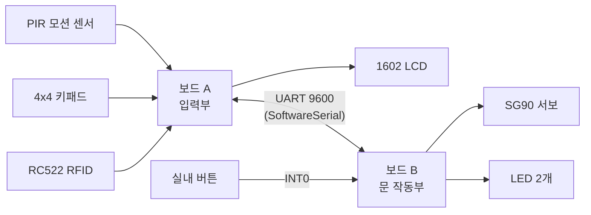

# Arduino 스마트 도어락 (기말 과제)

Arduino Uno(ATmega328P) **2대**를 UART로 연결해 만든 도어락이다.
사람이 다가오면 PIR 모션 센서가 감지해 키패드를 활성화하고, 키패드 비밀번호·RFID 카드·실내 버튼으로 문을 연다.
열린 문은 5초 뒤 자동으로 잠긴다. (블루투스 기능은 현재 제외했고, 나중에 추가할 수 있다.)

> 🧊 도어락 틀 3D 도면(보드 A 박스 STL 3개, 전체 완성 STEP, 웹 3D 뷰어)은 [`cad/README.md`](cad/README.md)와 [`docs/case3d.html`](docs/case3d.html)에 있다.
>
> 📐 실물 비율 브레드보드 배치도, 단계별 배선 순서, 분압 회로 확대도, 보드 A 테스트, 안전 점검표는 [`docs/wiring.html`](docs/wiring.html)을 브라우저로 열면 볼 수 있다.

---

## 목차
1. [전체 구성](#1-전체-구성)
2. [작동 과정](#2-작동-과정)
3. [준비물](#3-준비물)
4. [배선](#4-배선)
5. [만드는 순서](#5-만드는-순서)
6. [설정값 바꾸기](#6-설정값-바꾸기)
7. [문제 해결](#7-문제-해결)
8. [파일 구조](#8-파일-구조)
9. [한계와 개선점](#9-한계와-개선점)

---

## 1. 전체 구성

| 보드 | 역할 | 연결된 모듈 |
|---|---|---|
| **A (입력부)** | 모션 감지 → 키패드 활성, 비밀번호·RFID 판정, LCD 표시 | PIR 모션 센서, 4x4 키패드, RC522 RFID, 1602 LCD(I2C) |
| **B (문 작동부)** | 문 열고 닫기, 자동 잠금, LED 표시 | SG90 서보, LED 2개(빨강·초록), 실내 버튼 |



### 과제 조건 대응
| 조건 | 구현 |
|---|---|
| 보드 2대 시리얼 통신 | 보드 A `A1(RX)/A2(TX)` ↔ 보드 B `D5(TX)/D4(RX)`, SoftwareSerial 9600bps |
| 외부 인터럽트 | 보드 B `D2` = INT0, 실내 버튼, `FALLING`, `millis()` 300ms로 채터링 방지 |
| 내부 인터럽트 | 보드 B `MsTimer2` 100ms 주기, 5초 자동 잠금 / LED 표시 |
| 키패드 | PIR이 사람을 감지한 뒤 10초 동안만 입력 가능 (`*` 지우기, `#` 확인) |
| RFID | 등록된 카드 UID 비교 (항상 동작) |
| 디스플레이 | LCD에 안내(`Wave to start`), 입력값(`*`), 결과, 문 상태 표시 |
| LED | 초록=열림, 빨강=잠김 / 빠른 깜빡임=인증 실패 |
| 블루투스 | 현재 제외 (추후 추가 예정) |

---

## 2. 작동 과정

### 2-1. 모션 감지 → 키패드 활성
1. 평소 LCD 2번째 줄에는 `Wave to start`가 뜨고, 키패드를 눌러도 반응하지 않는다.
2. PIR 센서(D9)가 사람을 감지하면 키패드가 **활성화**되고 LCD 2번째 줄이 `PW:`로 바뀐다.
3. 마지막 움직임이나 키 입력 뒤 **10초** 동안 아무것도 없으면 다시 비활성화되고, 입력하던 비밀번호는 지워진다.

### 2-2. 키패드로 열기
1. 숫자를 누르면 LCD 2번째 줄에 `PW:****`처럼 `*`가 늘어난다. `*`는 전체 지우기, `A`~`D`는 무시된다.
2. `#`을 누르면 보드 A가 비밀번호(기본 `1234`)와 비교한다.
3. **맞으면** LCD에 `ACCESS GRANTED`가 뜨고, 보드 B로 `OPEN:KEY`를 보낸다.
4. 보드 B가 먼저 보드 A로 `ST:OPEN:KEY`를 보내고, 그다음 서보를 90°로 돌려 문을 연다. 초록 LED는 100ms 타이머 인터럽트가 켠다.
   - 상태를 먼저 보내는 이유: SoftwareSerial로 보내는 동안 인터럽트가 잠깐 막혀서 서보 펄스가 흔들리기 때문이다.
5. 5초 뒤 보드 B의 타이머 인터럽트가 자동 잠금 플래그를 세운다. 서보는 0°로 돌아가고, 보드 A로 `ST:LOCK`이 간다.
6. **틀리면** LCD에 `ACCESS DENIED` / `KEY`가 뜨고, 보드 A가 `FAIL:KEY`를 보내 보드 B가 빨강 LED를 2초 동안 빠르게 깜빡인다.

### 2-3. RFID로 열기
1. 카드를 RC522에 대면 보드 A가 카드의 4바이트 UID를 읽는다. (모션 감지와 상관없이 항상 동작)
2. 코드의 `ALLOWED_UID` 목록과 같으면 `ACCESS GRANTED`를 띄우고 `OPEN:RFID`를 보낸다. 이후는 키패드와 같다.
3. 등록되지 않은 카드면 `ACCESS DENIED` / `RFID`가 뜨고 `FAIL:RFID`를 보낸다.

### 2-4. 실내 버튼으로 열기 (외부 인터럽트)
1. 버튼은 `D2`와 GND 사이에 연결되고, `INPUT_PULLUP`이라 평소에는 HIGH다.
2. 누르는 순간 HIGH → LOW로 떨어지면(`FALLING`) INT0 인터럽트가 실행된다.
3. ISR은 직전 실행으로부터 300ms가 지났을 때만 플래그를 세운다(채터링 방지).
4. `loop()`가 플래그를 보고 문을 열고, 보드 A로 `ST:OPEN:BTN`을 보낸다. LCD에는 `OPEN from INSIDE button`이 뜬다.

### 2-5. 타이머 인터럽트 (MsTimer2, 100ms)
`isrTick()`이 100ms마다 실행되면서 아래 일을 한다.

| 카운터 | 하는 일 |
|---|---|
| `openTicks` (50 = 5초) | 0이 되면 자동 잠금 플래그 |
| `servoOffTicks` (8 = 0.8초) | 0이 되면 서보 detach 플래그 (떨림·전류 감소) |
| `failTicks` (20 = 2초) | 0이 될 때까지 빨강 LED 빠르게 깜빡임 |

LED 표시도 ISR에서 직접 처리한다. 서보 이동이나 시리얼 전송 같은 무거운 일은 ISR에서 하지 않는다. ISR은 `volatile` 플래그만 세우고, 실제 처리는 `loop()`가 한다.

### 2-6. 보드 간 통신 규약
한 줄에 메시지 하나를 보낸다. 보낼 때는 `println()`이라 줄 끝이 `\r\n`이고, 받는 쪽은 `\r`나 `\n` 중 하나만 와도 한 줄로 처리한다(빈 줄은 무시).

| 방향 | 메시지 | 의미 |
|---|---|---|
| A → B | `OPEN:KEY`, `OPEN:RFID` | 문 열기 |
| A → B | `FAIL:KEY`, `FAIL:RFID` | 실패 표시 (빨강 LED 깜빡) |
| B → A | `ST:OPEN:KEY` / `RFID` / `BTN` | 문이 열림 (+ 연 방법) |
| B → A | `ST:LOCK` | 문이 잠김 |

### 2-7. 상태 표시
| LED (보드 B) | 의미 |
|---|---|
| 🔴 빨강 켜짐 | 잠김 |
| 🔴 빨강 빠르게 깜빡 | 인증 실패 (2초) |
| 🟢 초록 켜짐 | 열림 (5초 뒤 자동 잠금) |

| LCD (보드 A) | 상황 |
|---|---|
| `Door:LOCKED` / `Wave to start` | 기본 화면, 키패드 비활성 |
| `Door:LOCKED` / `PW:***` | 모션 감지됨, 비밀번호 입력 중 |
| `ACCESS GRANTED` / `ACCESS DENIED` | 키패드·RFID 인증 결과 (2줄에 `KEY` 또는 `RFID`) |
| `OPEN from INSIDE button` | 실내 버튼으로 열림 |

---

## 3. 준비물

| 부품 | 수량 | 비고 |
|---|---|---|
| Arduino Uno R3 | 2 | ATmega328P, USB 케이블 2개 |
| PIR 모션 센서 (HC-SR501) | 1 | **5V** 전원 |
| 4x4 멤브레인 키패드 | 1 | |
| RC522 RFID 모듈 + 카드/태그 | 1 | **3.3V 전용** |
| 1602 LCD + I2C 모듈(PCF8574) | 1 | 뒷면에 4핀(GND·VCC·SDA·SCL) |
| SG90 서보모터 | 1 | |
| LED (빨강, 초록) | 각 1 | |
| 푸시 버튼 | 1 | |
| 저항 1kΩ | 3 | RC522 분압 3채널의 핀 쪽 |
| 저항 2kΩ | 3 | RC522 분압 3채널의 GND 쪽 |
| 저항 220Ω | 2 | LED 2개 |
| 전해 커패시터 470µF | 1 | 서보 전원 안정화 (없으면 생략 가능) |
| 브레드보드, 점퍼선 | | |

### 라이브러리 (Arduino IDE → Library Manager, `Ctrl+Shift+I`)
| 검색어 | 작성자 | 필요한 보드 |
|---|---|---|
| `LiquidCrystal I2C` | **Frank de Brabander** | A |
| `Keypad` | **Mark Stanley, Alexander Brevig** | A |
| `MFRC522` | **GithubCommunity** (miguelbalboa) | A |
| `MsTimer2` | Javier Valencia (PaulStoffregen 관리) | B |

`Wire`, `SPI`, `SoftwareSerial`, `Servo`는 기본 내장이다.
> ⚠️ 이름이 비슷한 다른 라이브러리(`Adafruit Keypad`, `MFRC522v2`, `LiquidCrystal_PCF8574` 등)는 사용법이 달라서 컴파일되지 않는다. **작성자 이름**을 확인하고 설치한다.

---

## 4. 배선

**브레드보드 레일 순서:** 이 프로젝트에서 쓰는 브레드보드는 레일 쌍마다 **−가 위, +가 아래**다. 위쪽 쌍은 바깥이 −, a줄 쪽이 +이고, 아래쪽 쌍은 j줄 쪽이 −, 바깥이 +다. 다른 브레드보드를 쓰면 레일 옆의 색·기호를 보고 맞춘다.

### 보드 A (입력부)
| 모듈 핀 | 보드 A 핀 | 비고 |
|---|---|---|
| PIR OUT | D9 | |
| PIR VCC / GND | 아래쪽 + 레일(5V) / − 레일 | ⚠️ PIR은 **5V**. 3.3V로는 동작 안 함 |
| 키패드 C4, C3, C2, C1 | D8, D7, D6, D5 | 키패드 핀 1~4번 (위부터) |
| 키패드 R1, R2, R3, R4 | D4, D3, D2, A0 | 키패드 핀 5~8번 |
| RC522 SDA(SS) | D10 | 1kΩ / 2kΩ 분압 |
| RC522 SCK | D13 | 1kΩ / 2kΩ 분압 |
| RC522 MOSI | D11 | 1kΩ / 2kΩ 분압 |
| RC522 MISO | D12 | **직결** |
| RC522 RST | **3.3V** | 저항 없이 3.3V에 직결 (코드는 리셋 핀 사용 안 함) |
| RC522 3.3V / GND | 위쪽 + 레일(**3.3V**) / GND | ⚠️ 5V 금지. IRQ는 연결 안 함 |
| LCD SDA / SCL | A4 / A5 | |
| LCD VCC / GND | 아래쪽 + 레일(5V) / − 레일 | |
| 링크 RX / TX | A1 / A2 | 보드 B의 D5 / D4로 |

보드 A의 브레드보드는 **위쪽 + 레일 = 3.3V**(RC522용), **아래쪽 + 레일 = 5V**(LCD·PIR용)다. 두 + 레일을 헷갈리지 않는다.

**분압 회로**(RC522 SDA·SCK·MOSI 3채널)는 이렇게 만든다.
```
아두이노 핀 ──[1kΩ]──┬── RC522 핀   (5V × 2000/3000 ≈ 3.33V)
                     │
                  [2kΩ]
                     │
                    GND
```
- RC522는 2.3V 이상이면 HIGH로 읽고 최대 약 3.8V까지 버티므로 3.33V는 안전한 범위다.
- 핀이 HIGH일 때 흐르는 전류는 약 1.7mA다. 모듈 쪽에서 본 저항이 약 667Ω(1k‖2k)이라 SPI 4MHz 신호도 충분히 빨리 따라온다.
- **1kΩ이 핀 쪽, 2kΩ이 GND 쪽**이다. 바꿔 꽂으면 1.67V가 되어 신호를 못 읽는다.
- 분압은 브레드보드 아래쪽 절반(f~j줄)에 만들어, 2kΩ이 j줄 바로 아래 **− 레일**에 꽂히게 한다. 위치가 아니라 색·기호로 확인한다.
- 전원을 끄고 선을 뺀 상태에서 각 채널의 N칸↔− 레일 ≈ 2kΩ, P칸↔− 레일 ≈ 3kΩ이면 맞다.
- 10kΩ으로 분압하면 저항이 커서 SPI(4MHz) 신호가 제때 올라가지 못해 통신이 깨진다.
- 브레드보드 배치(어느 칸에 꽂는지)는 [`docs/wiring.html`](docs/wiring.html)의 "분압 회로 자세히"에 그림으로 있다.

### 보드 B (문 작동부)
| 모듈 핀 | 보드 B 핀 | 비고 |
|---|---|---|
| 실내 버튼 | D2 ↔ GND | 저항 필요 없음 (`INPUT_PULLUP`) |
| 링크 RX / TX | D4 / D5 | 보드 A의 A2 / A1로 |
| 초록 / 빨강 LED | D10 / D12 | 각각 220Ω 직렬. 긴 다리(+)가 저항 쪽 |
| SG90 신호(주황) | A0 | |
| SG90 전원(빨강) / GND(갈색) | 아래쪽 + 레일(우노 5V) / − 레일 | + / − 레일 사이에 470µF (긴 다리 +). 외부 전원 없음 |

### 보드 A ↔ 보드 B
| 보드 A | 보드 B |
|---|---|
| A2 (TX) | D4 (RX) |
| A1 (RX) | D5 (TX) |
| GND | GND |

TX와 RX는 서로 **엇갈려** 연결한다. **두 보드의 5V끼리는 연결하지 않는다.** 각 보드는 자기 USB로 전원을 받는다.

### ⚠️ 보드나 모듈이 망가질 수 있는 실수
1. **RC522 VCC를 5V에 연결하기.** 반드시 3.3V(보드 A 위쪽 + 레일)에 연결한다.
2. **서보에 9V 연결하기.** SG90은 4.8~6V용이다. 서보는 우노 5V로만 쓴다.
3. **두 보드의 5V 핀끼리 연결하기.**
4. **470µF 커패시터 극성 반대로 꽂기.** 긴 다리가 +, 띠 표시 쪽이 −다.

---

## 5. 만드는 순서

**한 번에 다 꽂지 말고**, 모듈 하나 연결 → 테스트 → 다음 순서로 진행한다. 배선은 항상 **USB를 뽑은 상태**에서 한다.

### 1단계: 준비
1. Arduino IDE를 설치하고 [라이브러리](#라이브러리-arduino-ide--library-manager-ctrlshifti) 4개를 설치한다.
2. `도구 → 보드 → Arduino Uno`, `도구 → 포트`에서 연결된 포트를 선택한다.

### 2단계: 보드 A 만들고 테스트
`firmware/tests/`의 테스트 스케치를 순서대로 올린다. 시리얼 모니터는 **9600**으로 맞춘다.

| 순서 | 연결할 것 | 업로드할 스케치 | 통과 기준 |
|---|---|---|---|
| ① | LCD | `tools/i2c_scanner` | `Found: 0x27`(또는 `0x3F`) 출력. 다른 값이면 `A1_lcd_test.ino`와 `board_A_input.ino`의 `LCD_ADDR`를 그 값으로 수정 |
| ② | (그대로) | `tests/A1_lcd_test` | 백라이트가 **5초마다 깜빡임**. 글자가 안 보이면 LCD 뒷면 가변저항 조절 |
| ③ | 키패드 | `tests/A2_keypad_test` | 16개 키가 표와 같은 글자로 출력됨. 다르면 스케치 주석의 표대로 핀 순서 수정 |
| ④ | RC522 + 분압 저항 | `tests/A3_rfid_test` | `OK: RC522 responds` 출력. 카드를 대면 나오는 `{0x.., ...},`를 기록 |
| ⑤ | A2–A1 사이 점퍼선 (보드 B 링크선은 빼기) | `tests/A4_link_loopback` | `PASS`가 1초마다 출력. 끝나면 점퍼 제거 |
| ⑥ | PIR | `tests/A5_pir_test` | 손을 흔들면 `MOTION`, 가만히 있으면 몇 초 뒤 `-`. 전원 넣고 처음 30~60초는 안정화 시간 |
| ⑦ | (전부) | `board_A_input` | 아래 표대로 LCD 확인 |

④에서 얻은 UID를 `board_A_input.ino`의 `ALLOWED_UID`에 붙여 넣고 업로드한다.
```cpp
const uint8_t UID_COUNT = 2;
const uint8_t ALLOWED_UID[UID_COUNT][4] = {
  {0xDE, 0xAD, 0xBE, 0xEF},   // ← 내 카드 UID
  {0x12, 0x34, 0x56, 0x78},   // ← 내 태그 UID
};
```

**보드 A만 확인하기** (보드 B 없이도 PIR·키패드·RFID·LCD는 확인할 수 있다. 문 상태 표시는 보드 B를 연결한 뒤 확인)

| 해볼 것 | 기대 결과 (LCD) |
|---|---|
| 아무것도 안 함 | `Door:LOCKED` / `Wave to start`, 키패드 반응 없음 |
| 센서 앞에서 손 흔들기 | 2줄이 `PW:`로 바뀜 |
| `1234#` | `ACCESS GRANTED` / `KEY` |
| 틀린 번호 + `#` | `ACCESS DENIED` / `KEY` |
| 등록 카드 / 미등록 카드 | `ACCESS GRANTED` / `ACCESS DENIED` (2줄 `RFID`) |
| 10초 동안 가만히 | 다시 `Wave to start` |

### 3단계: 보드 B 만들고 테스트
| 순서 | 연결할 것 | 확인 방법 |
|---|---|---|
| ① | LED 2개 + 버튼 | `board_B_door` 업로드. 빨강이 켜져 있고, 버튼을 누르면 초록이 5초 동안 켜짐 |
| ② | 우노 5V 레일 + 470µF + 서보 | 버튼을 누르면 0° → 90° → (5초 뒤) 0°로 움직임. 이때 보드가 리셋되지 않아야 함. **걸쇠에 달기 전에** 각도 확인 |

> 서보는 우노 5V(USB)로 동작한다. 470µF는 반드시 꽂고, 무거운 걸쇠는 달지 않는다. 서보가 움직일 때 보드가 리셋되면 USB를 PC 뒷면 포트나 2A 충전기로 바꾼다.

### 4단계: 두 보드 연결
1. A2→D4, D5→A1, GND–GND를 연결한다.
2. 키패드·RFID·버튼 3가지 방법으로 모두 열리는지, 5초 뒤 자동으로 잠기는지 확인한다.
3. 버튼으로 열었을 때 보드 A의 LCD에 `OPEN from INSIDE button`이 뜨면 양방향 통신도 정상이다.

### 5단계: 문에 설치
1. 서보 혼(날개)에 걸쇠를 연결하고, `LOCK_ANGLE` / `UNLOCK_ANGLE`을 실제 걸쇠 위치에 맞게 조정한다.
2. PIR 센서는 문 바깥쪽 사람이 다가오는 방향을 향하게 설치한다.
3. 실내 버튼은 문 안쪽에 설치한다.

### 최소화 코드 (`firmware/minimal/`)
발표용으로 핵심 동작만 남긴 버전이다. 배선은 위와 같다.
- **보드 A → B 단방향**만 쓴다. 메시지는 글자 하나(`O` 열기 / `F` 실패)다. A1 ← D5 선은 없어도 된다.
- 문 상태(`Door:OPEN`, 버튼으로 열림)는 LCD에 표시하지 않고 보드 B의 LED로만 보여준다.
- 결과 화면은 `delay(2000)`으로 2초 보여주고, 서보는 계속 붙여 둔다(detach 안 함).
- 카드 UID는 `myCard` 1개만 등록한다.

---

## 6. 설정값 바꾸기

| 파일 | 상수 | 기본값 | 의미 |
|---|---|---|---|
| A | `PASSWORD` | `"1234"` | 키패드 비밀번호 |
| A | `ALLOWED_UID` | 예시 2개 | 등록된 RFID UID |
| A | `LCD_ADDR` | `0x27` | LCD I2C 주소 |
| A | `ACTIVE_MS` | 10000 | 모션 감지 후 키패드 활성 시간(ms) |
| B | `LOCK_ANGLE` / `UNLOCK_ANGLE` | 0 / 90 | 서보 각도 |
| B | `OPEN_TICKS` | 50 | 열림 유지 시간 (×100ms = 5초) |

A = `firmware/board_A_input/board_A_input.ino`, B = `firmware/board_B_door/board_B_door.ino`

---

## 7. 문제 해결

| 증상 | 확인할 것 |
|---|---|
| `xxx.h: No such file or directory` | 해당 라이브러리 설치 (작성자 확인) |
| LCD 백라이트만 켜지고 글자 없음 | A1 테스트에서 백라이트가 깜빡이면 가변저항(명암)을 조절. 안 깜빡이면 주소와 A4/A5 배선 확인 |
| 키패드 글자가 엉뚱함 | A2 테스트 주석 참고: `1→1, 2→4`면 커넥터가 위아래 거꾸로 (`rowPins`와 `colPins` 맞바꾸기) |
| 키패드가 전혀 반응 없음 | PIR이 사람을 감지했는지(LCD에 `PW:` 표시), A5 테스트로 PIR 확인 |
| PIR이 계속 감지됨 | 전원 직후 30~60초 안정화 기다리기, 뒷면 감도 가변저항 줄이기 |
| RFID `FAIL: no response` | 3.3V 연결, RST가 3.3V인지, D10~D13 배선, 분압 방향 (핀 → 1kΩ → 모듈 → 2kΩ → GND) |
| RFID `FAIL: unstable reads` | 분압 저항, MISO 선 접촉 불량 |
| 서보가 움직일 때 보드가 리셋됨 | 470µF 극성·접촉, 걸쇠 부하 줄이기, USB 포트를 PC 뒷면이나 2A 충전기로 |
| 보드 간 통신 안 됨 | TX↔RX 엇갈림, GND 공통, 양쪽 9600 |

---

## 8. 파일 구조
```
├── README.md
├── docs/
│   ├── wiring.html                 배선도, 안전 점검표, 조립 순서 (브라우저로 열기)
│   └── case3d.html                 도어락 틀 3D 도면 뷰어 (치수·재단 목록·조립 순서)
├── cad/                            3D 도면
│   ├── doorlock_case.py            도면 생성 스크립트 (CadQuery)
│   ├── print/                      3D 프린터용 STL (박스 본체·뒷판·레일 브래킷)
│   └── assembly/                   전체 완성 도면 (STEP, GLB)
├── tools/wiring/                   배선도 데이터 검사 스크립트
└── firmware/
    ├── board_A_input/              보드 A 메인 스케치
    ├── board_B_door/               보드 B 메인 스케치
    ├── minimal/                    핵심 기능만 남긴 최소화 코드
    │   ├── board_A_min/
    │   └── board_B_min/
    ├── tools/
    │   └── i2c_scanner/            LCD I2C 주소 찾기
    └── tests/                      보드 A 모듈별 테스트
        ├── A1_lcd_test/
        ├── A2_keypad_test/
        ├── A3_rfid_test/
        ├── A4_link_loopback/
        └── A5_pir_test/
```

---

## 9. 한계와 개선점
- **PIR은 움직임만 감지한다.** 누가 왔는지는 모르고, 가만히 서 있으면 10초 뒤 비활성화된다. 키를 누르는 동안에는 시간이 연장된다.
- **보안은 학습용 수준이다.** 비밀번호와 UID가 코드에 평문으로 들어 있다. 실패 횟수 제한(무작위 대입 방지)은 발표용 코드를 단순하게 하려고 넣지 않았다.
- **서보는 잠근 뒤 detach한다.** 떨림을 막으려는 것이라 유지 토크가 없다. 실제 문에 쓰려면 걸쇠 구조를 보강해야 한다.
- **개선 아이디어:** 블루투스(HC-06) 다시 추가 / EEPROM에 비밀번호·UID 저장 / 키패드로 비밀번호 변경 / 부저 추가(단, MsTimer2와 `tone()`이 충돌하므로 능동 부저 사용)
